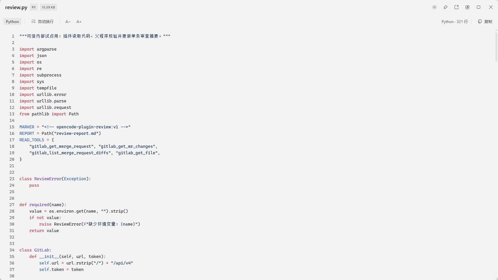
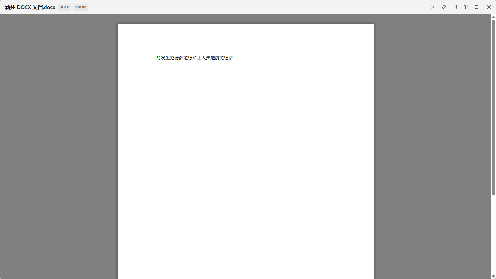
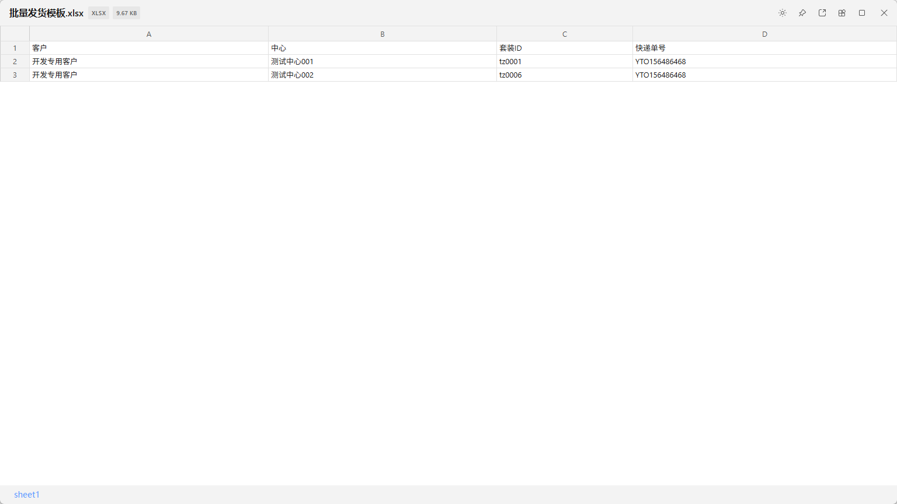
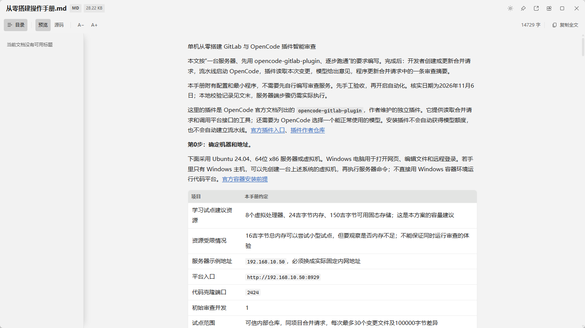
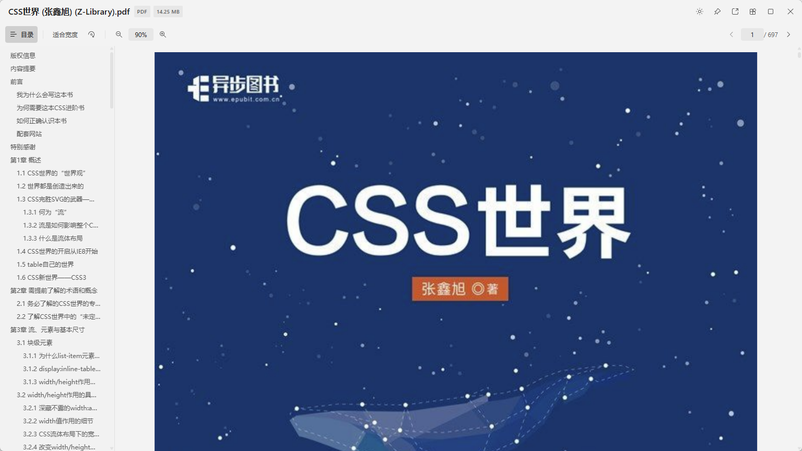
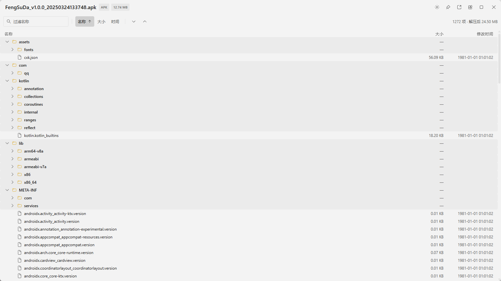
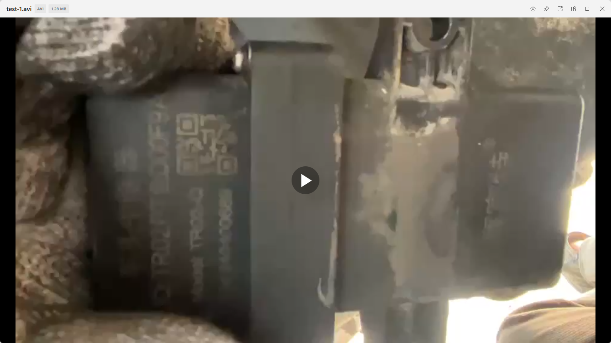
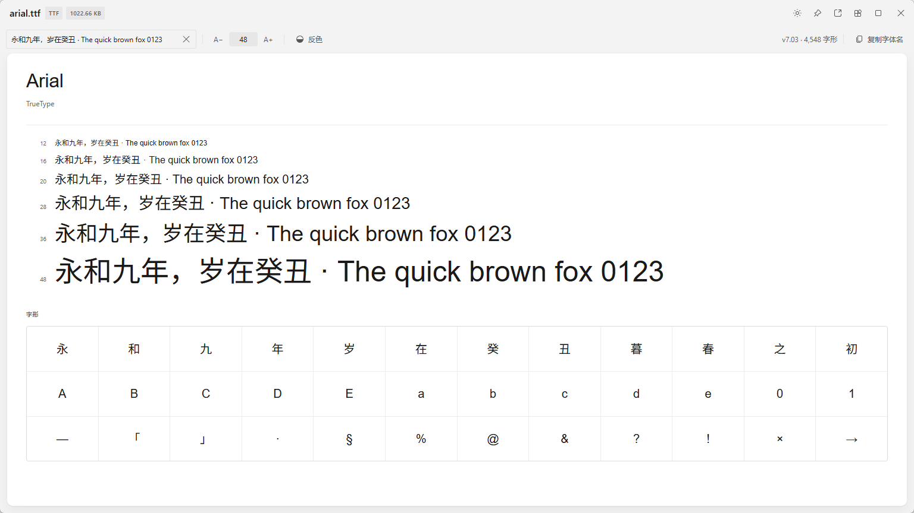

# quicklook

QuickLook 是一个 windows 平台的快速预览工具。

## 主要功能

- 在文件资源管理器（Explorer）预览
- 在桌面（Desktop）预览
- 在文件选择弹窗（FileOpenDialog）预览
- 界面支持简体中文与英文，默认简体中文，可在设置页切换（托盘菜单同步）

## 支持预览的格式

- Markdown：markdown、md
- Doc：docx、xls、xlsx、xlsm、xlsb、xla、xlam、ods、csv、pdf
- Code：txt、cpp、js、mjs、cjs、ts、mts、tsx、rs、py、java、html、css、scss、sass、less、styl、c、cs、go、vue、svelte、astro、jsx、json、yml、yaml、toml、bat、ps1、ini、swift、kt、php、h、xml、sql、pug、lua、r、d、vb、pas、scala、dart、rb、m、log、bash、zig
- Image：jpg、jpeg、png、gif、webp、bmp、ico、svg、apng、psd、tiff、tif、tga、pbm、pgm、ppm、qoi、exr、heic、heif、jxl
- Video：mp4、webm、mkv、avi、mov、wmv、mpg、mpeg、m4v、3gp、3g2
- Audio：mp3、ogg、m4a、wav、flac、opus
- Book：epub
- Font：ttf、otf、woff2、woff
- Archive：zip、7z、rar、tar、gz、tgz、bz2、tbz2、xz、txz、zst、tzst、cpio、ar、a、deb、jar、war、ear、apk、aar、whl、vsix、nupkg、crx、xpi、egg、kra、xps、oxps
- 3D Model：gltf、glb、stl、obj、ply、fbx、3mf、dae、3ds、amf、wrl、lwo、lws

## 如何运行项目

### 前置依赖

- Rust [官方网站](https://www.rust-lang.org/tools/install)
- Tauri [官方网站](https://tauri.app/start/prerequisites/)
- NodeJS [官方网站](https://nodejs.org/)

### 拉取项目代码

```bash
git clone https://github.com/GuoJikun/quicklook.git 
```

### 运行项目

> 推荐使用 pnpm；
> 使用 Volta 来锁定 NodeJS 和 pnpm 版本

```bash
pnpm i
# 安装项目依赖

pnpm tauri dev
# 运行项目
```

### 构建 ffmpeg 二进制（首次打包前必须执行）

视频预览依赖随包分发的精简版 ffmpeg（LGPL 构建，不含 GPL 组件）：

```bash
./scripts/build-ffmpeg.sh                  # x64
TARGET_ARCH=arm64 ./scripts/build-ffmpeg.sh # arm64（需 llvm-mingw，见下）
```

x64 在 MSYS2 MINGW64 下原生编译：

```bash
pacman -S --needed base-devel mingw-w64-x86_64-gcc mingw-w64-x86_64-nasm make
```

arm64 在 x64 主机上交叉编译，需要 [llvm-mingw](https://github.com/mstorsjo/llvm-mingw/releases)
（选 `*-ucrt-x86_64.zip`），把解压后的 `bin` 目录加进 PATH。MSYS2 只有 x86_64 的
mingw-w64 工具链，装不出 aarch64 产物；脚本会校验 `aarch64-w64-mingw32-gcc` 是否存在，
缺失直接报错，不会静默退回宿主机的编译器。

脚本产出 `src-tauri/binaries/{ffmpeg,ffprobe}-<triple>.exe`（已加入 `.gitignore`），
Tauri 打包时按 target triple 自动选取对应架构。拷贝产物前会读 PE 头的 Machine 字段
校验架构（x64 为 `0x8664`、arm64 为 `0xaa64`），交叉工具链配错时在构建阶段就失败，
不会把错误架构的二进制塞进安装包。

两个二进制由脚本分两阶段构建，组件白名单不同：

| 产物 | 用途 | 启用组件 | 体积（x64 / arm64） |
| --- | --- | --- | --- |
| `ffmpeg.exe` | HLS 转码 | `h264_mf` / `aac` 编码器、常用解码器、`hls` / `mpegts` 封装、转码链路必需的滤镜 | 11 MB / 5.1 MB |
| `ffprobe.exe` | 读取容器元数据 | 仅解封装、解析器与 `aac` 解码器（ts 内 AAC 的采样率/声道数只能由解码器补齐），无滤镜、无编码器 | 4.3 MB / 1.5 MB |

arm64 体积明显更小，是因为 x86 的 SIMD 汇编（尤其 h264/hevc 解码）代码量大得多，
两边启用的组件完全相同（可对比 `config_components.h`）。

两者均以 `--disable-everything` 为基准、按白名单显式启用，因此新增功能时若用到
新的解码器或滤镜，必须同步写进 `scripts/build-ffmpeg.sh`，否则运行期会报
`no decoder found for: xxx` 或 `Error configuring filter graph`。

只调整 `ffmpeg` 的构建参数时，可用 `SKIP_FFPROBE=1 ./scripts/build-ffmpeg.sh`
跳过 ffprobe 阶段，省去一次无谓的全量重编。

> 注意：`bundle.externalBin` 在编译期校验文件是否存在，**未构建 ffmpeg 时 `cargo check` /
> `pnpm tauri dev` 会直接报 `resource path ... doesn't exist`**。本地首次开发前需要执行
> 上面的脚本；CI 的 `PublishApp` 工作流会在打包前自动构建（MSYS2 + llvm-mingw），
> 产物按架构缓存，脚本一改缓存即失效重编。

### 打包

```bash
pnpm tauri build
```

## 使用到的开源软件

详见 [THIRD_PARTY_LIB.md](./THIRD_PARTY_LIB.md)

## 软件截图

### 预览 Code (utf-8)



### 预览 Docx



### 预览 Excel



### 预览 Image


### 预览 Md



### 预览 Pdf



### 预览 Zip



### 预览 Video



### 预览 Audio


### 预览 Fonts



## License/许可证

项目使用了 MIT 和 Apache 2.0。
